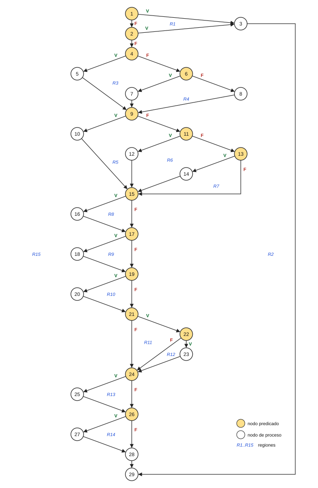

# Parte 4 - Caja blanca

Se analiza la función `calc` de la versión heredada 1.0.0 (`envios.py`,
líneas 13 a 42).

## 4.1 Grafo de flujo

La condición compuesta de la línea 14 (`p <= 0 or p > 50`) se separa en dos
nodos predicado (1 y 2), porque el `or` evalúa en cortocircuito y cada
condición simple es una decisión.

| Nodo | Línea | Sentencia | Tipo |
|------|-------|-----------|------|
| 1 | 14 | `p <= 0` | Predicado |
| 2 | 14 | `p > 50` | Predicado |
| 3 | 15 | `raise ValueError("peso invalido")` | Proceso |
| 4 | 16 | `if p <= CONFIG["L1"]` | Predicado |
| 5 | 17 | `t = 6000` | Proceso |
| 6 | 18 | `elif p <= CONFIG["L2"]` | Predicado |
| 7 | 19 | `t = 9000` | Proceso |
| 8 | 21 | `t = 9000 + (p - CONFIG["L2"]) * 800` | Proceso |
| 9 | 22 | `if z == "urbana"` | Predicado |
| 10 | 23 | `t = t` | Proceso |
| 11 | 24 | `elif z == "rural"` | Predicado |
| 12 | 25 | `t = t + t * CONFIG["RECARGO_RURAL"]` | Proceso |
| 13 | 26 | `elif z == "nacional"` | Predicado |
| 14 | 27 | `t = t + t * CONFIG["RECARGO_NACIONAL"]` | Proceso |
| 15 | 29 | `if d > 6` | Predicado |
| 16 | 30 | `t = t + CONFIG["RECARGO_FINDE"]` | Proceso |
| 17 | 31 | `if c == "frecuente"` | Predicado |
| 18 | 32 | `t = t - t * 0.05` | Proceso |
| 19 | 33 | `if c == "vip"` | Predicado |
| 20 | 34 | `t = t - t * CONFIG["DESC_VIP"]` | Proceso |
| 21 | 35 | `if cup != None` | Predicado |
| 22 | 36 | `if cup == "ENVIO10"` | Predicado |
| 23 | 37 | `t = t - t * 0.10` | Proceso |
| 24 | 38 | `if t < 5000` | Predicado |
| 25 | 39 | `t = 5000` | Proceso |
| 26 | 40 | `if flag` | Predicado |
| 27 | 41 | `print("costo:", t)` | Proceso |
| 28 | 42 | `return int(t / 100) * 100` | Proceso |
| 29 | - | Fin (salida única: llegan el `raise` y el `return`) | Proceso |

## 4.2 Complejidad ciclomática

**a) Con aristas y nodos:** V(G) = E − N + 2

- Aristas: los 14 nodos predicado tienen 2 salidas cada uno (28 aristas) y
  los 14 nodos de proceso que no son el final tienen 1 salida (14 aristas).
  E = 28 + 14 = **42**
- Nodos: N = **29**
- V(G) = 42 − 29 + 2 = **15**

**b) Con nodos predicado:** V(G) = P + 1

- Nodos predicado: 1, 2, 4, 6, 9, 11, 13, 15, 17, 19, 21, 22, 24 y 26 →
  P = **14**
- V(G) = 14 + 1 = **15**

**c) Con regiones:** V(G) = número de regiones del grafo

- Regiones cerradas: R1 a R14 (marcadas en el grafo).
- Región exterior: R15.
- V(G) = 14 + 1 = **15**

Las tres formas dan **V(G) = 15**. La herramienta `radon` confirma el valor:
`calc - C (15)`. Es una complejidad alta para una sola función (más de 10 ya
se considera difícil de probar y mantener), y se reduce en la Parte 6.

## 4.3 Caminos independientes y casos de prueba

Como V(G) = 15, el conjunto básico tiene 15 caminos. El camino 3 es el camino
base; cada uno de los demás recorre al menos una arista nueva.

| # | Camino (nodos) | Entradas `calc(p, z, c, d, cup, flag)` | Esperado según la especificación | Caso |
|---|----------------|-----------------------------------------|----------------------------------|------|
| 1 | 1-3-29 | `0, "urbana", "normal", 1` | Error | CB-01 |
| 2 | 1-2-3-29 | `51, "urbana", "normal", 1` | Error | CB-02 |
| 3 | 1-2-4-6-7-9-10-15-17-19-21-24-26-28-29 | `5, "urbana", "normal", 1` | $9.000 | CB-03 |
| 4 | 1-2-4-**5**-9-10-15-17-19-21-24-26-28-29 | `2, "urbana", "normal", 1` | $6.000 | CB-04 |
| 5 | 1-2-4-6-**8**-9-10-15-17-19-21-24-26-28-29 | `20, "urbana", "normal", 1` | $17.000 | CB-05 |
| 6 | 1-2-4-6-7-9-**11-12**-15-17-19-21-24-26-28-29 | `5, "rural", "normal", 1` | $10.800 | CB-06 |
| 7 | 1-2-4-6-7-9-11-**13-14**-15-17-19-21-24-26-28-29 | `5, "nacional", "normal", 1` | $13.500 | CB-07 |
| 8 | 1-2-4-6-7-9-11-**13-15**-17-19-21-24-26-28-29 | `5, "internacional", "normal", 1` | Error (R2) | CB-08 |
| 9 | 1-2-4-6-7-9-10-15-**16**-17-19-21-24-26-28-29 | `5, "urbana", "normal", 7` | $11.000 | CB-09 |
| 10 | 1-2-4-6-7-9-10-15-17-**18**-19-21-24-26-28-29 | `5, "urbana", "frecuente", 1` | $8.600 | CB-10 |
| 11 | 1-2-4-6-7-9-10-15-17-19-**20**-21-24-26-28-29 | `5, "urbana", "vip", 1` | $8.100 | CB-11 |
| 12 | 1-2-4-6-7-9-10-15-17-19-21-**22-23**-24-26-28-29 | `5, "urbana", "normal", 1, "ENVIO10"` | $8.100 | CB-12 |
| 13 | 1-2-4-6-7-9-10-15-17-19-21-**22-24**-26-28-29 | `5, "urbana", "normal", 1, "OTRO"` | Error (R7) | CB-13 |
| 14 | 1-2-4-5-9-10-15-17-19-20-21-22-23-24-**25**-26-28-29 | `2, "urbana", "vip", 1, "ENVIO10"` | $5.000 | CB-14 |
| 15 | 1-2-4-6-7-9-10-15-17-19-21-24-26-**27**-28-29 | `5, "urbana", "normal", 1, None, True` | $9.000 e imprime `costo:` | CB-15 |

Notas:

- El camino 14 necesita cambiar varias decisiones a la vez: la única forma de
  que el costo baje de $5.000 es tramo 1 con VIP y cupón
  (6.000 × 0,90 × 0,90 = 4.860).
- En los caminos 8 y 13 el **código** devuelve un valor, pero la
  **especificación** exige error. Esos dos casos fallan contra la versión
  1.0.0 y destapan los defectos DEF-02 y DEF-05.
- El camino 10 pasa por la sentencia del descuento, pero el resultado falla
  por el redondeo (DEF-06): recorrer un camino no garantiza que el resultado
  sea correcto.

Los 15 casos están en `tests/test_caja_blanca.py`.

## 4.4 Cobertura de sentencias y de ramas

**Cobertura de sentencias (100 %).** Se logra con 9 casos: CB-01, CB-03,
CB-05, CB-06, CB-07, CB-09, CB-10, CB-14 y CB-15.

| Sentencia | Caso que la ejecuta |
|-----------|---------------------|
| `raise` (nodo 3) | CB-01 |
| `t = 9000` (7), `t = t` (10), `return` (28) | CB-03 |
| tramo 3 (8) | CB-05 |
| recargo rural (12) | CB-06 |
| recargo nacional (14) | CB-07 |
| recargo de fin de semana (16) | CB-09 |
| descuento frecuente (18) | CB-10 |
| `t = 6000` (5), descuento VIP (20), descuento de cupón (23), `t = 5000` (25) | CB-14 |
| `print` (27) | CB-15 |

CB-04, CB-11 y CB-12 no hacen falta para sentencias porque CB-14 ya ejecuta
el tramo 1, el descuento VIP y el descuento del cupón.

Medido con solo esos 9 casos: 29 de 29 sentencias, pero quedan 2 ramas sin
recorrer (`26->29` y `36->38` en el reporte de cobertura).

**Cobertura de ramas (100 %).** A los 9 casos anteriores hay que sumar los
que toman la salida *falsa* de dos decisiones que no tienen `else`:

| Rama que falta | Línea | Caso |
|----------------|-------|------|
| `z == "nacional"` falso (13 → 15) | 26 | CB-08 |
| `cup == "ENVIO10"` falso (22 → 24) | 36 | CB-13 |

Con esos **11 casos** (CB-01, CB-03, CB-05 a CB-10, CB-13, CB-14 y CB-15)
quedan cubiertas las 26 ramas que mide `coverage.py`.

**Cobertura de condiciones.** `coverage.py` cuenta el `if` de la línea 14
como una sola decisión, así que CB-01 basta para su rama verdadera. CB-02
(`p > 50` verdadero con `p <= 0` falso) se necesita para cubrir la segunda
condición del `or`, que es justamente donde está el defecto DEF-01.

Resultado medido con `pytest --cov=envios --cov-branch` sobre la versión
1.0.0 con la suite completa: **29 de 29 sentencias y 26 de 26 ramas
(100 %)**. Aun con cobertura total, 20 pruebas fallan: la cobertura dice qué
código se ejecutó, no que el código haga lo que pide la especificación.
