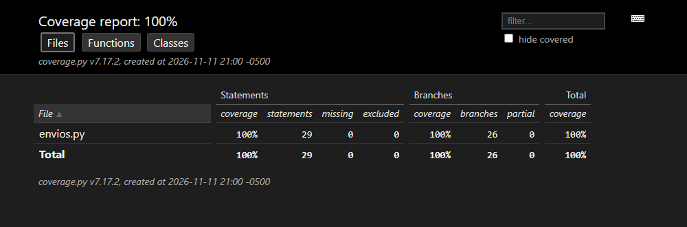
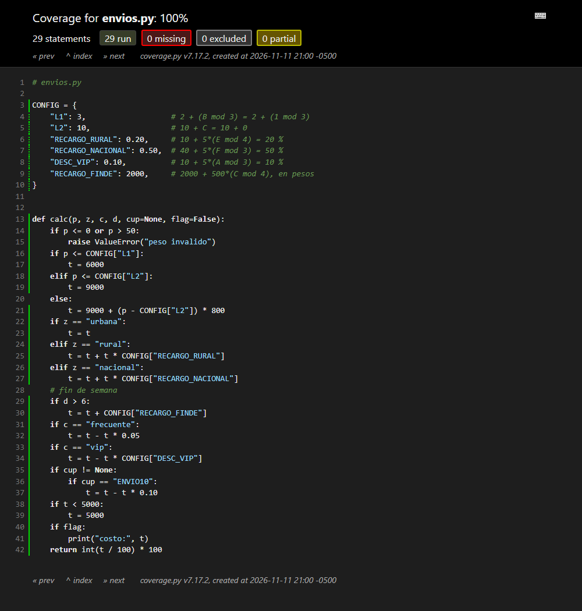

# Parte 5 - Automatización, ejecución y defectos

## 5.1 Automatización

Todos los casos están automatizados con **pytest**:

| Archivo | Casos | Pruebas |
|---------|-------|---------|
| `tests/test_caja_negra.py` | CN-01 a CN-42 | 42 |
| `tests/test_caja_blanca.py` | CB-01 a CB-15 | 15 |
| **Total** | | **57** |

Cada prueba lleva el ID del caso, de modo que un fallo se rastrea directo a la
matriz de la Parte 3 o a los caminos de la Parte 4.

Ejecución contra el código heredado (etiqueta `v1.0.0`, sin modificar):

```bash
python -m pytest -v --tb=line --cov=envios --cov-branch --cov-report=term-missing
```

Resultado: **20 fallan y 37 pasan**. La salida completa está en
[`evidencias/01-pruebas-v1.0.0-heredado.txt`](evidencias/01-pruebas-v1.0.0-heredado.txt)
y el detalle de cada fallo en
[`evidencias/02-detalle-fallos-v1.0.0.txt`](evidencias/02-detalle-fallos-v1.0.0.txt).

```text
FAILED tests/test_caja_blanca.py::test_CB_08_zona_que_no_existe - Failed: DID NOT RAISE ValueError
FAILED tests/test_caja_blanca.py::test_CB_10_cliente_frecuente - assert 8500 == 8600
FAILED tests/test_caja_blanca.py::test_CB_13_cupon_que_no_existe - Failed: DID NOT RAISE ValueError
FAILED tests/test_caja_negra.py::test_costo_esperado[CN-11] - assert 36900 == 37000
FAILED tests/test_caja_negra.py::test_costo_esperado[CN-21] - assert 9000 == 11000
FAILED tests/test_caja_negra.py::test_costo_esperado[CN-25] - assert 8500 == 8600
FAILED tests/test_caja_negra.py::test_costo_esperado[CN-26] - assert 7600 == 7700
FAILED tests/test_caja_negra.py::test_costo_esperado[CN-28] - assert 7200 == 7300
FAILED tests/test_caja_negra.py::test_costo_esperado[CN-30] - assert 10400 == 10500
FAILED tests/test_caja_negra.py::test_costo_esperado[CN-38] - assert 8700 == 10400
FAILED tests/test_caja_negra.py::test_costo_esperado[CN-39] - assert 13300 == 15000
FAILED tests/test_caja_negra.py::test_costo_esperado[CN-41] - assert 6800 == 8700
FAILED tests/test_caja_negra.py::test_entrada_invalida_lanza_error[CN-13] - Failed: DID NOT RAISE ValueError
FAILED tests/test_caja_negra.py::test_entrada_invalida_lanza_error[CN-14] - Failed: DID NOT RAISE ValueError
FAILED tests/test_caja_negra.py::test_entrada_invalida_lanza_error[CN-17] - Failed: DID NOT RAISE ValueError
FAILED tests/test_caja_negra.py::test_entrada_invalida_lanza_error[CN-18] - Failed: DID NOT RAISE ValueError
FAILED tests/test_caja_negra.py::test_entrada_invalida_lanza_error[CN-23] - Failed: DID NOT RAISE ValueError
FAILED tests/test_caja_negra.py::test_entrada_invalida_lanza_error[CN-34] - Failed: DID NOT RAISE ValueError
FAILED tests/test_caja_negra.py::test_entrada_invalida_lanza_error[CN-35] - Failed: DID NOT RAISE ValueError
FAILED tests/test_caja_negra.py::test_CN_42_mensaje_de_peso_invalido - assert 'peso invalido' == 'peso inválido'
======================== 20 failed, 37 passed in 0.59s ========================
```

## 5.2 Cobertura

Medida con **pytest-cov** (coverage.py) con cobertura de ramas:

```text
Name        Stmts   Miss Branch BrPart  Cover   Missing
-------------------------------------------------------
envios.py      29      0     26      0   100%
-------------------------------------------------------
TOTAL          29      0     26      0   100%
```

- Cobertura de sentencias: **29 / 29 = 100 %**
- Cobertura de ramas: **26 / 26 = 100 %**

Capturas del reporte HTML de coverage.py
(`python -m pytest --cov=envios --cov-branch --cov-report=html`) sobre la
versión 1.0.0:





Todas las líneas quedan marcadas en verde (ejecutadas) y no hay ramas
parciales.

## 5.3 Registro de defectos

Qué líneas del código heredado **son** defecto y cuáles **no** depende de mi
especificación:

| Línea | Código | ¿Defecto para mi código? |
|-------|--------|--------------------------|
| 14 | `p > 50` | **Sí** - mi PMAX es 45 (DEF-01) |
| 15 | `"peso invalido"` | **Sí** - la especificación pide "peso inválido" (DEF-07) |
| 16 | `p <= CONFIG["L1"]` | No - D = 0 es par, el límite sí se incluye |
| 22-27 | zonas sin `else` | **Sí** - una zona inválida no da error (DEF-02) |
| 29 | `d > 6` | **Sí** - deja por fuera el sábado (DEF-04) y no valida el día (DEF-03) |
| 29-30 | recargo antes de los descuentos | No - E = 6 es par, va antes |
| 31-37 | se aplican los dos descuentos | No - B = 1 es impar, se aplican ambos |
| 35-37 | cupón desconocido se ignora | **Sí** - F = 5 es impar, debe ser error (DEF-05) |
| 42 | `int(t / 100) * 100` | **Sí** - trunca en vez de redondear (DEF-06) |

### DEF-01 - Acepta envíos de más de 45 kg

| Campo | Detalle |
|-------|---------|
| **Requisito que incumple** | R1 (0 < peso ≤ 45) |
| **Pasos para reproducir** | 1. Llenar CONFIG con mis valores. 2. Ejecutar `calc(45.01, "urbana", "normal", 1)`. 3. Ejecutar `calc(50, "urbana", "normal", 1)`. |
| **Resultado esperado** | En los dos casos, error "peso inválido". |
| **Resultado obtenido** | Devuelve $37.000 y $41.000: el envío se acepta y se cobra. |
| **Causa** | Línea 14: el tope está escrito a mano como `50` y no usa PMAX = 45. |
| **Casos que lo detectan** | CN-13, CN-14 |
| **Severidad** | **Alta.** El sistema acepta paquetes que la empresa no está en capacidad de transportar; el envío se cobra y luego no se puede despachar. |
| **Prioridad** | **Alta.** Es una regla de operación básica y la corrección es de una línea. |

### DEF-02 - Una zona que no existe se cobra como urbana

| Campo | Detalle |
|-------|---------|
| **Requisito que incumple** | R2 (zona inválida → error) |
| **Pasos para reproducir** | 1. Ejecutar `calc(5, "internacional", "normal", 1)`. |
| **Resultado esperado** | Error por zona inválida. |
| **Resultado obtenido** | Devuelve $9.000, como si fuera urbana. |
| **Causa** | Líneas 22-27: la cadena `if / elif` no tiene `else`; cualquier texto pasa sin recargo. |
| **Casos que lo detectan** | CN-17, CB-08 |
| **Severidad** | **Alta.** Un error de digitación ("Rural" con mayúscula, "nacinal") hace que no se cobre el recargo del 20 % o 50 %, y se aceptan destinos que la empresa no atiende. |
| **Prioridad** | **Media.** Normalmente la zona se escoge de una lista, así que ocurre menos que DEF-04 y DEF-06. |

### DEF-03 - No valida que el día esté entre 1 y 7

| Campo | Detalle |
|-------|---------|
| **Requisito que incumple** | R2 (día fuera de 1 a 7 → error) |
| **Pasos para reproducir** | 1. Ejecutar `calc(5, "urbana", "normal", 0)`. 2. Ejecutar `calc(5, "urbana", "normal", 8)`. |
| **Resultado esperado** | Error en los dos casos. |
| **Resultado obtenido** | Con día 0 devuelve $9.000. Con día 8 devuelve $11.000: además lo trata como fin de semana. |
| **Causa** | No existe ninguna validación del día; la única comparación es `d > 6` (línea 29). |
| **Casos que lo detectan** | CN-18, CN-23 |
| **Severidad** | **Media.** Produce cobros con datos imposibles (día 8 cobra recargo), pero solo si llega un día inválido. |
| **Prioridad** | **Media.** Se corrige junto con las demás validaciones. |

### DEF-04 - El sábado no cobra el recargo de fin de semana

| Campo | Detalle |
|-------|---------|
| **Requisito que incumple** | R5 (sábado y domingo: +$2.000) |
| **Pasos para reproducir** | 1. Ejecutar `calc(5, "urbana", "normal", 6)`. |
| **Resultado esperado** | $11.000 (9.000 + 2.000). |
| **Resultado obtenido** | $9.000: no suma el recargo. |
| **Causa** | Línea 29: `d > 6` solo es verdadero el domingo (7). Debería ser `d >= 6`. |
| **Casos que lo detectan** | CN-21, CN-38, CN-39, CN-41 |
| **Severidad** | **Crítica.** La empresa deja de cobrar $2.000 en **todos** los envíos de **todos** los sábados. Es pérdida de dinero directa y repetida. |
| **Prioridad** | **Urgente.** Es el primero que se debe corregir: cada sábado que pasa cuesta dinero y el arreglo es un solo carácter. |

### DEF-05 - Un cupón que no existe se ignora en silencio

| Campo | Detalle |
|-------|---------|
| **Requisito que incumple** | R7 (para mi código, F = 5 impar: es error) |
| **Pasos para reproducir** | 1. Ejecutar `calc(5, "urbana", "normal", 1, "NOEXISTE")`. 2. Ejecutar `calc(5, "urbana", "vip", 7, "envio10")`. |
| **Resultado esperado** | Error por cupón inválido en los dos casos. |
| **Resultado obtenido** | Devuelve $9.000 y $9.900: cobra sin descuento y sin avisar. |
| **Causa** | Líneas 35-37: si el cupón no es `ENVIO10` simplemente no hace nada. |
| **Casos que lo detectan** | CN-34, CN-35, CB-13 |
| **Severidad** | **Media.** El cliente cree que usó un cupón y paga el valor completo sin enterarse; genera reclamos, pero la empresa no pierde dinero. |
| **Prioridad** | **Media.** |

### DEF-06 - El resultado se trunca en vez de redondearse

| Campo | Detalle |
|-------|---------|
| **Requisito que incumple** | R8 (redondeo al múltiplo de $100 más cercano; los $50 suben) |
| **Pasos para reproducir** | 1. Ejecutar `calc(5, "urbana", "frecuente", 1)`. 2. Ejecutar `calc(44.99, "urbana", "normal", 1)`. |
| **Resultado esperado** | $8.600 (8.550 sube) y $37.000 (36.992 sube). |
| **Resultado obtenido** | $8.500 y $36.900. |
| **Causa** | Línea 42: `int(t / 100) * 100` corta los decimales, siempre hacia abajo. |
| **Casos que lo detectan** | CN-11, CN-25, CN-26, CN-28, CN-30, CB-10 (y también afecta a CN-38 y CN-39) |
| **Severidad** | **Alta.** Afecta a cualquier envío cuyo valor termine entre $50 y $99: se cobran hasta $99 de menos por envío. Es poco por envío pero ocurre todos los días. |
| **Prioridad** | **Alta.** |

### DEF-07 - El mensaje de error no coincide con la especificación

| Campo | Detalle |
|-------|---------|
| **Requisito que incumple** | R1 (el error es "peso inválido") |
| **Pasos para reproducir** | 1. Ejecutar `calc(0, "urbana", "normal", 1)` y leer el mensaje del error. |
| **Resultado esperado** | `ValueError` con el mensaje `peso inválido`. |
| **Resultado obtenido** | `ValueError` con el mensaje `peso invalido` (sin tilde). |
| **Causa** | Línea 15: texto mal escrito. |
| **Casos que lo detectan** | CN-42 |
| **Severidad** | **Baja.** Es cosmético: el error sí se lanza. Solo afectaría a quien compare el texto exacto. |
| **Prioridad** | **Baja.** Se corrige porque es barato, al final. |

### Resumen

| ID | Título | Requisito | Severidad | Prioridad | Casos que fallan |
|----|--------|-----------|-----------|-----------|------------------|
| DEF-01 | Acepta envíos de más de 45 kg | R1 | Alta | Alta | 2 |
| DEF-02 | Zona inexistente se cobra como urbana | R2 | Alta | Media | 2 |
| DEF-03 | No valida el día | R2 | Media | Media | 2 |
| DEF-04 | El sábado no cobra recargo | R5 | Crítica | Urgente | 4 |
| DEF-05 | Cupón inexistente se ignora | R7 | Media | Media | 3 |
| DEF-06 | Trunca en vez de redondear | R8 | Alta | Alta | 6 |
| DEF-07 | Mensaje de error sin tilde | R1 | Baja | Baja | 1 |
| | | | | **Total** | **20** |

**Defectos enmascarados.** CN-38 y CN-39 fallan primero por DEF-04 (es
sábado), pero aunque se corrija ese defecto seguirían fallando por DEF-06
(10.368 y 14.985 se truncarían). Por eso se vuelve a ejecutar toda la suite
después de cada corrección.

**Observaciones que no son defecto** (la especificación no las cubre):

- Un tipo de cliente desconocido se acepta y se cobra sin descuento.
- El parámetro `flag` imprime en consola; es un mal olor, se trata en la
  Parte 6.

## 5.4 Métricas

| Métrica | Cálculo | Valor |
|---------|---------|-------|
| Casos ejecutados | 42 de caja negra + 15 de caja blanca | 57 |
| Casos que pasan | 37 / 57 | **64,9 %** |
| Casos que fallan | 20 / 57 | 35,1 % |
| Defectos encontrados | | **7** |
| Defectos por severidad | Crítica 1 · Alta 3 · Media 2 · Baja 1 | 7 |
| Densidad de defectos (función `calc`, 30 líneas) | 7 / 30 × 100 | **23,3 defectos por cada 100 líneas** |
| Densidad de defectos (archivo completo, 42 líneas) | 7 / 42 × 100 | 16,7 defectos por cada 100 líneas |
| Cobertura de sentencias | 29 / 29 | **100 %** |
| Cobertura de ramas | 26 / 26 | **100 %** |
| Complejidad ciclomática de `calc` | radon | 15 |

Lectura: con el 100 % de cobertura todavía falla el 35 % de los casos. La
cobertura sola no encuentra defectos de **omisión** (validaciones que faltan,
como DEF-02, DEF-03 y DEF-05): no se puede cubrir código que no existe. Esos
defectos solo los encuentran las pruebas de caja negra hechas contra la
especificación.
