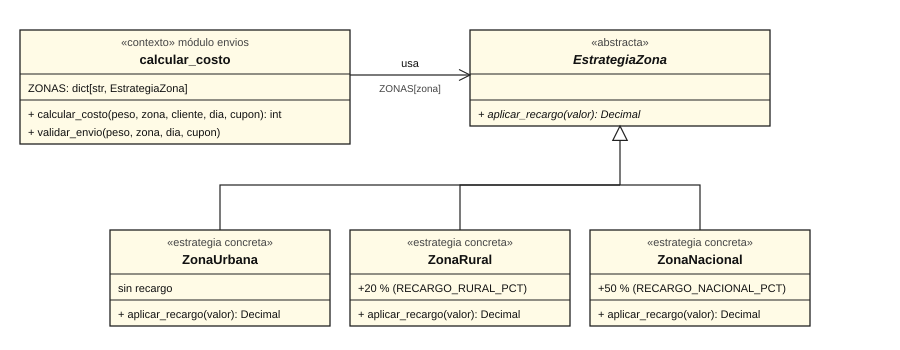
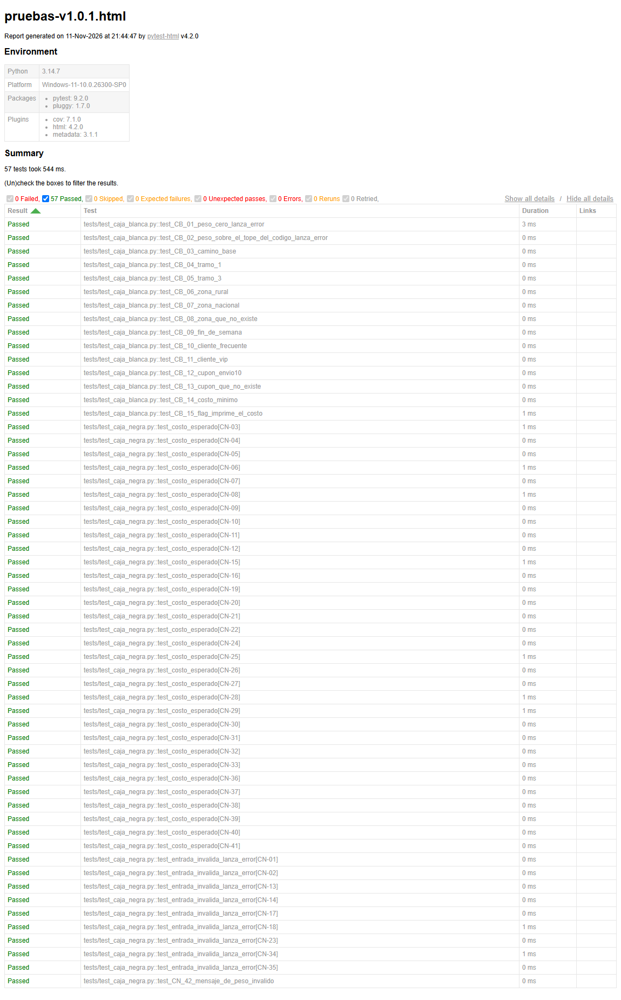
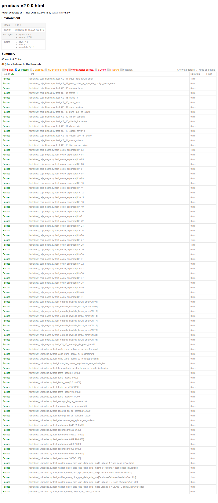
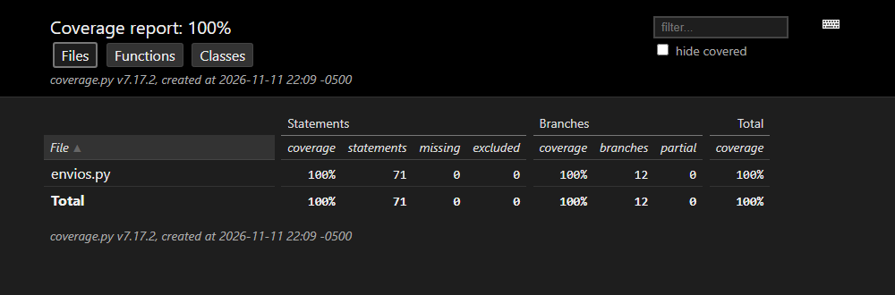

# Parte 6 - Mantenimiento y refactorización

## 6.1 Malos olores del código heredado

Las líneas son las de `envios.py` en la versión 1.0.0.

| # | Mal olor (nombre técnico) | Línea(s) | Dónde se ve | Deuda técnica que genera |
|---|---------------------------|----------|-------------|--------------------------|
| 1 | **Números mágicos** (Magic Numbers) | 14, 17, 19, 21, 29, 32, 37, 38, 39, 42 | `50`, `6000`, `9000`, `800`, `6`, `0.05`, `0.10`, `5000`, `100` escritos directo en el código | Nadie sabe qué significa cada número ni cuáles dependen de la tarifa. El `50` de la línea 14 quedó desactualizado frente al peso máximo real y produjo DEF-01. Cambiar una tarifa obliga a buscar el número por todo el código. |
| 2 | **Método largo** (Long Method) con varias responsabilidades | 13-42 | Una sola función valida, calcula la tarifa, recarga por zona y fin de semana, descuenta, aplica el mínimo, redondea e imprime | Complejidad ciclomática de 15. No se puede probar ni cambiar una regla sin tocar las demás; cada cambio arriesga todo el cálculo. |
| 3 | **Argumento bandera** (Flag Argument) con efecto secundario | 13, 40-41 | `flag=False` decide si la función además imprime | La función hace dos cosas (calcular e imprimir). Mezcla lógica de negocio con salida por consola y duplica los caminos a probar. |
| 4 | **Nombres poco comunicativos** (Mysterious Name) | 13 y todo el cuerpo | `calc`, `p`, `z`, `c`, `d`, `cup`, `t`, `flag` | Hay que leer todo el cuerpo para saber qué es cada cosa; es fácil pasar los argumentos en el orden equivocado. |
| 5 | **Código muerto** (Dead Code) | 22-23 | `if z == "urbana": t = t` | Una asignación que no hace nada: confunde al lector y esconde que falta el `else` de zona inválida (DEF-02). |
| 6 | **Sentencias switch / condicionales sobre un tipo** (Switch Statements) | 22-27 y 31-34 | Cadenas `if / elif` que comparan `z` y `c` contra textos | Agregar una zona o un tipo de cliente obliga a modificar `calc` (viola abierto/cerrado). Es justo lo que resuelve el patrón Estrategia. |
| 7 | **Código duplicado** (Duplicated Code) | 25, 27, 32, 34, 37 | El mismo cálculo `t = t ± t * porcentaje` repetido cinco veces | Si cambia la forma de aplicar un porcentaje hay que corregir cinco lugares y es fácil olvidar uno. |
| 8 | **Obsesión por primitivos** (Primitive Obsession) | 22-36 | Zonas, clientes y cupones son textos sueltos sin lista de valores válidos | No hay validación: cualquier texto pasa. De ahí salen DEF-02 y DEF-05. |
| 9 | **Datos globales mutables** (Global Data) | 3-10 | `CONFIG` es un diccionario global con claves de texto | Cualquier parte del programa lo puede cambiar; un error en una clave solo se descubre al ejecutar (`KeyError`). |
| 10 | **Comentario como desodorante** (Comments) | 28 | `# fin de semana` sobre `if d > 6` | El comentario dice una cosa y el código hace otra (solo domingo): el comentario tapó DEF-04. El código debería explicarse solo. |
| 11 | **Dinero en punto flotante** | 25-37, 42 | Valores en pesos calculados con `float` | Errores de representación (por ejemplo 8.549,999… en vez de 8.550) que cambian el redondeo. |

## 6.2 Clasificación de los cambios

| Cambio | Tipo de mantenimiento | Por qué |
|--------|-----------------------|---------|
| Corregir DEF-01 a DEF-07 | **Correctivo** | Arreglan fallas: el código no hacía lo que dice la especificación. |
| Reemplazar números mágicos por constantes con nombre | **Perfectivo** | Mejora la legibilidad y la facilidad de cambio sin alterar el resultado. |
| Extraer funciones y renombrar (`calcular_costo`, `peso`, `zona`…) | **Perfectivo** | Reduce la complejidad; el comportamiento es el mismo. |
| Eliminar el argumento `flag` y el `print` | **Perfectivo** | Quita una responsabilidad que no es del cálculo. Cambia la interfaz (ver Parte 7). |
| Eliminar `t = t` | **Perfectivo** | Limpieza de código muerto. |
| Patrón Estrategia para las zonas | **Perfectivo y preventivo** | Mejora el diseño y deja el sistema listo para zonas nuevas sin tocar `calcular_costo`. |
| Manejar el dinero con `Decimal` | **Preventivo** | Evita errores futuros de redondeo por punto flotante antes de que aparezcan. |
| Validar que el día sea un entero de 1 a 7 (no 6,5) | **Preventivo** | Cierra una entrada rara antes de que cause un cobro mal hecho. |
| Pruebas de unidad para cada función extraída | **Preventivo** | Red de seguridad para los cambios que vienen. |
| Hora pico (Parte 8) | **Perfectivo** | Es una funcionalidad nueva que pide el negocio. |
| (ninguno) | **Adaptativo** | No hubo cambios de entorno: mismo lenguaje, misma plataforma. Sería adaptativo, por ejemplo, migrar a otra versión de Python o a otro sistema de facturación. |

## 6.3 Refactorización

Se hizo en la rama `refactor/estrategia`, **después** de corregir los defectos
y con la suite en verde, en dos pasos pequeños:

**Paso 1 - Extraer funciones, constantes con nombre y eliminar `flag`.**

| Antes (dentro de `calc`) | Después |
|--------------------------|---------|
| Validaciones repartidas por el cuerpo | `validar_envio(peso, zona, dia, cupon)` |
| `if p <= L1 … elif … else` | `tarifa_base(peso)` |
| `if d >= 6: t = t + …` | `recargo_fin_de_semana(dia)` |
| Tres `if` de descuentos | `aplicar_descuentos(valor, cliente, cupon)` |
| `if t < 5000 …` y `int(round(…))` | `redondear(valor)` |
| `t = t ± t * x` repetido | `sumar_porcentaje` y `restar_porcentaje` |
| `50`, `6000`, `9000`, `800`, `0.05`, `5000`, `100`… | `PESO_MAXIMO_KG`, `TARIFA_TRAMO_1`, `TARIFA_TRAMO_2`, `TARIFA_KG_ADICIONAL`, `DESCUENTO_FRECUENTE_PCT`, `COSTO_MINIMO`, `MULTIPLO_REDONDEO`… |
| `calc(p, z, c, d, cup=None, flag=False)` | `calcular_costo(peso, zona, cliente, dia, cupon=None)`; `calc` se conserva como alias |
| `flag` y `print("costo:", t)` | Eliminados: quien quiera ver el costo imprime el valor que devuelve la función |
| `t = t` | Eliminada |
| Dinero en `float` | `Decimal`, con redondeo `ROUND_HALF_UP` |

**Paso 2 - Patrón Estrategia para el recargo por zona.**

La cadena `if / elif` de zonas se reemplazó por una familia de clases con la
misma interfaz. `calcular_costo` ya no pregunta qué zona es: le pide a la
estrategia de esa zona que aplique su recargo.



```python
class EstrategiaZona(ABC):
    @abstractmethod
    def aplicar_recargo(self, valor): ...

class ZonaUrbana(EstrategiaZona):
    def aplicar_recargo(self, valor):
        return valor

class ZonaRural(EstrategiaZona):
    def aplicar_recargo(self, valor):
        return sumar_porcentaje(valor, RECARGO_RURAL_PCT)

class ZonaNacional(EstrategiaZona):
    def aplicar_recargo(self, valor):
        return sumar_porcentaje(valor, RECARGO_NACIONAL_PCT)

ZONAS = {"urbana": ZonaUrbana(), "rural": ZonaRural(), "nacional": ZonaNacional()}

# en calcular_costo:
valor = ZONAS[zona].aplicar_recargo(valor)
```

Participantes del patrón:

| Rol | En el código |
|-----|--------------|
| Estrategia (interfaz) | `EstrategiaZona` |
| Estrategias concretas | `ZonaUrbana`, `ZonaRural`, `ZonaNacional` |
| Contexto | `calcular_costo`, que escoge la estrategia con `ZONAS[zona]` |

Ventaja: para agregar una zona se crea una clase nueva y se registra en
`ZONAS`; `calcular_costo` y `validar_envio` no se tocan (la validación usa el
mismo diccionario).

## 6.4 Corrección de los defectos

Cada defecto se corrigió en su propia rama, en orden de prioridad, con el
cambio mínimo sobre el código heredado. Después de cada rama se ejecutó toda
la suite:

| Orden | Rama | Corrección | Fallan antes | Fallan después |
|-------|------|------------|--------------|----------------|
| 1 | `fix/DEF-04` | `d > 6` → `d >= 6` | 20 | 18 |
| 2 | `fix/DEF-06` | Redondeo al múltiplo de 100 más cercano en vez de truncar | 18 | 10 |
| 3 | `fix/DEF-01` | Tope de peso `50` → `CONFIG["PMAX"]` = 45 | 10 | 8 |
| 4 | `fix/DEF-02` | `else: raise ValueError("zona inválida")` | 8 | 6 |
| 5 | `fix/DEF-03` | Validación `d < 1 or d > 7` | 6 | 4 |
| 6 | `fix/DEF-05` | `else: raise ValueError("cupón inválido")` | 4 | 1 |
| 7 | `fix/DEF-07` | Mensaje `"peso inválido"` | 1 | **0** |

Al corregir DEF-04 solo se arreglaron 2 de sus 4 casos: CN-38 y CN-39 siguieron
fallando hasta corregir DEF-06, como se había previsto en la Parte 5
(defectos enmascarados).

## 6.5 Pruebas de regresión

Se ejecutaron **las mismas 57 pruebas** de las Partes 3 y 4, sin cambiar ningún
resultado esperado:

| Versión | Pasan | Fallan |
|---------|-------|--------|
| v1.0.0 (heredado) | 37 | 20 |
| v1.0.1 (defectos corregidos) | 57 | 0 |
| v2.0.0 (refactorizado) | 57 | 0 |

Captura del reporte de pytest sobre la versión corregida (v1.0.1): las 57
pruebas en verde.



Único ajuste a una prueba: **CB-15** probaba el camino de `flag=True`. Como el
parámetro se eliminó, ese camino ya no existe; la prueba ahora verifica que
pasar un sexto argumento posicional produce `TypeError`. No es una prueba que
se "acomodó" para pasar: es la consecuencia documentada del cambio de
interfaz.

Además se agregaron 31 pruebas de unidad (`tests/test_unidades.py`) para las
funciones extraídas y las estrategias. Total en v2.0.0: **88 pruebas, 88
pasan**.

```text
$ python -m pytest -q --cov=envios --cov-branch --cov-report=term-missing
........................................................................ [ 81%]
................                                                         [100%]
Name        Stmts   Miss Branch BrPart  Cover   Missing
-------------------------------------------------------
envios.py      71      0     12      0   100%
-------------------------------------------------------
TOTAL          71      0     12      0   100%
88 passed
```

La salida completa está en
[`evidencias/04-regresion-v2.0.0.txt`](evidencias/04-regresion-v2.0.0.txt).

Capturas sobre la versión refactorizada (v2.0.0): reporte de pytest con las
88 pruebas en verde y reporte de cobertura.





## 6.6 Antes y después

| Métrica | v1.0.0 (heredado) | v1.0.1 (corregido) | v2.0.0 (refactorizado) |
|---------|-------------------|--------------------|------------------------|
| Complejidad ciclomática de la función principal | 15 | 17 | **1** (`calcular_costo`) |
| Complejidad ciclomática máxima de una función | 15 | 17 | **6** (`validar_envio`) |
| Complejidad promedio por bloque | 15 | 17 | **1,75** |
| Funciones y métodos | 1 | 1 | 12 |
| Función más larga (líneas) | 30 | 36 | **10** |
| Líneas del archivo (LOC) | 42 | 49 | 135 |
| Líneas de código sin comentarios ni blancos (SLOC) | 37 | 44 | 79 |
| Números mágicos en la lógica | 9 | 12 | 0 (solo quedan el 100 de "por ciento" y el 0 de "peso positivo") |
| Cobertura de sentencias | 100 % (29/29) | 100 % (33/33) | 100 % (71/71) |
| Cobertura de ramas | 100 % (26/26) | 100 % (28/28) | 100 % (12/12) |
| Pruebas que pasan | 37 de 57 | 57 de 57 | 88 de 88 |

Lectura:

- Corregir los defectos **subió** la complejidad de 15 a 17: cada validación
  nueva era un `if` más en la misma función. Por eso se refactorizó después.
- La refactorización **aumentó** las líneas (de 49 a 135) pero bajó la
  complejidad de cada pieza: ninguna función pasa de 6 y la más larga tiene
  10 líneas. Más líneas, pero cada una más fácil de leer, probar y cambiar.
- Las ramas bajaron de 28 a 12 porque las decisiones sobre la zona y el
  cliente ya no son `if`: las resuelven el diccionario de estrategias y la
  tabla de descuentos.
- La cobertura se mantuvo en 100 % en las tres versiones.
