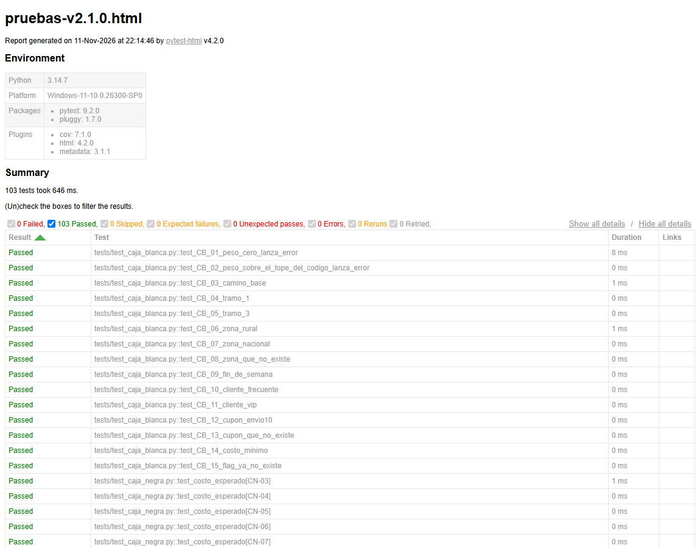
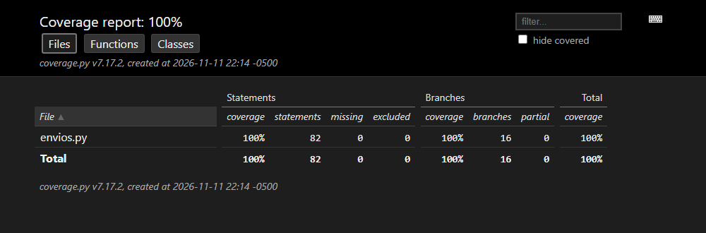

# Parte 8 - Solicitud de cambio y análisis de impacto

## 8.1 La solicitud que me corresponde

(A + F) mod 3 = (3 + 5) mod 3 = 8 mod 3 = **2**

> **CR-02 - Hora pico.** Se agrega el parámetro `hora` (de 0 a 23). Entre las
> 17 y las 19, inclusive, hay un recargo del 8 %, que se calcula después del
> recargo por zona.

La escribí como una regla nueva de la especificación:

| ID | Regla |
|----|-------|
| **R9** | La función recibe `hora`, un entero de 0 a 23. Si la hora está entre 17 y 19, inclusive, se suma un recargo del **8 %** sobre el valor que resulta de aplicar el recargo por zona. Una hora fuera de 0 a 23 es error. |

Decisiones que tomé donde la solicitud no dice nada:

1. **`hora` es opcional.** Si no se envía, no se cobra hora pico. Así los
   programas que ya llaman a la función siguen funcionando igual.
2. **`hora` solo se acepta por nombre** (`hora=18`). Antes, el sexto argumento
   posicional era `flag`; si `hora` ocupara ese lugar, una llamada vieja como
   `calc(5, "urbana", "normal", 1, None, True)` se interpretaría en silencio
   como "hora 1". Al exigir el nombre, esa llamada sigue dando `TypeError`.
3. **Orden.** El enunciado dice "después del recargo por zona". Con mis reglas
   el orden completo queda: tarifa base → zona → **hora pico** → fin de semana
   → descuentos → mínimo → redondeo. El recargo fijo de fin de semana no entra
   en la base del 8 %.
4. **Una hora no entera** (por ejemplo 18,5) se rechaza: la regla habla de
   horas de 0 a 23.

## 8.2 Análisis de impacto con la matriz de trazabilidad

Se recorrió la matriz de la Parte 1 preguntando, requisito por requisito, si
el cambio lo toca.

| Elemento | ¿Se afecta? | Detalle |
|----------|-------------|---------|
| **R1** peso | No | - |
| **R2** zona y día válidos | Sí (se amplía) | La validación ahora incluye la hora (0 a 23). |
| **R3** tarifa base | No | - |
| **R4** recargo por zona | Indirecto | No cambia, pero su resultado es la base del nuevo recargo. Los casos de zona sirven de regresión. |
| **R5** fin de semana | Indirecto | Hay que fijar el orden: la hora pico va antes de sumar los $2.000. |
| **R6** descuentos | Indirecto | Los descuentos se aplican sobre un valor que ahora puede traer el 8 %. |
| **R7** cupón | No | - |
| **R8** mínimo y redondeo | Indirecto | El 8 % produce valores con centavos (5.248,80): el redondeo debe seguir siendo correcto. |
| **R9** hora pico | **Nuevo** | Regla nueva. |

| Historias | ¿Se afecta? | Detalle |
|-----------|-------------|---------|
| HU-01 validar datos | Sí | Nuevo criterio: hora fuera de 0 a 23 → error. |
| HU-02 peso y zona | No | Sus casos se vuelven a ejecutar como regresión. |
| HU-03 fin de semana y descuentos | No (regresión) | Se agrega un caso que combina hora pico, domingo y VIP para fijar el orden. |
| **HU-04 hora pico** | **Nueva** | Ver abajo. |

**HU-04 - Cobrar recargo en hora pico (R9)**

> **Como** gerente de operaciones de EnvíaYa, **quiero** cobrar un recargo del
> 8 % a los envíos que se hacen entre las 17 y las 19, **para** compensar el
> mayor costo de despachar en las horas de más tráfico.

- **CA-04.1** **Dado** un envío de 5 kg urbano un lunes, **cuando** se hace a
  las 17, 18 o 19, **entonces** cuesta $9.700 (9.000 × 1,08 = 9.720).
- **CA-04.2** **Dado** el mismo envío, **cuando** se hace a las 16 o a las 20,
  **entonces** cuesta $9.000.
- **CA-04.3** **Dado** un envío de 5 kg a zona rural un lunes a las 18,
  **cuando** calculo el costo, **entonces** el 8 % se calcula sobre el valor
  con recargo de zona: 9.000 × 1,20 × 1,08 = 11.664 → $11.700.
- **CA-04.4** **Dado** un envío con hora −1 o 24, **cuando** calculo el costo,
  **entonces** el sistema lanza un error.
- **CA-04.5** **Dado** un envío sin hora, **cuando** calculo el costo,
  **entonces** el resultado es el mismo de antes del cambio.

| Casos de prueba | Impacto |
|-----------------|---------|
| CN-01 a CN-42, CB-01 a CB-15, pruebas de unidad | **No cambian.** Ninguno envía hora, así que todos deben seguir pasando: son la regresión. |
| HP-01 a HP-15 | **Nuevos** (`tests/test_hora_pico.py`). |

| Código | Impacto |
|--------|---------|
| Constantes | Nuevas: `HORAS_VALIDAS`, `HORA_PICO_INICIO`, `HORA_PICO_FIN`, `RECARGO_HORA_PICO_PCT`. |
| `validar_envio` | Se modifica: valida la hora. |
| `aplicar_hora_pico` | Función nueva. |
| `calcular_costo` | Se modifica: nuevo parámetro `hora` y un paso más en el cálculo. |
| `tarifa_base`, estrategias de zona, `recargo_fin_de_semana`, `aplicar_descuentos`, `redondear` | **No se tocan.** |

Fila nueva de la matriz de trazabilidad:

| Requisito | Historia | Criterios | Casos de prueba |
|-----------|----------|-----------|-----------------|
| R9 hora pico | HU-04 (y HU-01 por la validación) | CA-04.1 a CA-04.5 | HP-01 a HP-15 |

**Tamaño del impacto:** bajo. Gracias a la refactorización el cambio se
concentra en una función nueva de 5 líneas y en dos funciones que se modifican;
en la versión 1.0.0 habría sido otro `if` dentro de una función de complejidad
15.

**Riesgo principal:** aplicar el 8 % en el lugar equivocado del cálculo. Se
controla con los casos HP-10 y HP-11, que dan un resultado distinto si el
orden está mal.

## 8.3 Tipo de mantenimiento

**Perfectivo.** Es una funcionalidad nueva pedida por el negocio: el sistema
no tenía una falla (no es correctivo) ni cambió el entorno técnico o legal en
el que corre (no es adaptativo). Sería adaptativo si el recargo lo impusiera,
por ejemplo, una norma de tránsito externa a la empresa.

## 8.4 Implementación: las pruebas primero

Rama `feature/hora-pico`.

**Paso 1 - Escribir las pruebas y verlas fallar.** Se diseñaron los casos con
las mismas técnicas de la Parte 3. Base: 5 kg urbano lunes = $9.000.

| ID | Entradas | Hora | Cálculo a mano | Esperado | Técnica |
|----|----------|------|----------------|----------|---------|
| HP-01 | 5 kg, urbana, normal, lunes | 16 | 9.000 | $9.000 | VL (17) |
| HP-02 | 5 kg, urbana, normal, lunes | 17 | 9.000 × 1,08 = 9.720 | $9.700 | VL (17) |
| HP-03 | 5 kg, urbana, normal, lunes | 18 | 9.720 | $9.700 | PE (pico) |
| HP-04 | 5 kg, urbana, normal, lunes | 19 | 9.720 | $9.700 | VL (19) |
| HP-05 | 5 kg, urbana, normal, lunes | 20 | 9.000 | $9.000 | VL (19) |
| HP-06 | 5 kg, urbana, normal, lunes | 0 | 9.000 | $9.000 | VL (0) |
| HP-07 | 5 kg, urbana, normal, lunes | 23 | 9.000 | $9.000 | VL (23) |
| HP-08 | 5 kg, urbana, normal, lunes | −1 | - | Error | VL (0) |
| HP-09 | 5 kg, urbana, normal, lunes | 24 | - | Error | VL (23) |
| HP-10 | 5 kg, rural, normal, lunes | 18 | 9.000 × 1,20 = 10.800; × 1,08 = 11.664 | $11.700 | Orden: después de zona |
| HP-11 | 5 kg, urbana, vip, domingo | 17 | 9.720 + 2.000 = 11.720; × 0,90 = 10.548 | $10.500 | Orden: antes de fin de semana |
| HP-12 | 12,5 kg, nacional, vip, sábado, ENVIO10 | 19 | 11.000 × 1,50 = 16.500; × 1,08 = 17.820; + 2.000 = 19.820; × 0,90 = 17.838; × 0,90 = 16.054,2 | $16.100 | Combinación |
| HP-13 | 2 kg, urbana, vip, lunes, ENVIO10 | 18 | 6.000 × 1,08 = 6.480; × 0,90 × 0,90 = 5.248,8 | $5.200 | VL (costo mínimo) |
| HP-14 | 5 kg, urbana, normal, lunes | 18,5 | - | Error | PE (hora no entera) |
| HP-15 | Sin hora | - | Igual que antes | $9.000 y $10.400 | Compatibilidad |

Por qué HP-10 y HP-11 fijan el orden:

- **HP-10.** Si el 8 % se calculara sobre la tarifa base y no sobre el valor
  con zona: 10.800 + 9.000 × 0,08 = 11.520 → $11.500 (no $11.700).
- **HP-11.** Si el 8 % se aplicara después de sumar el fin de semana:
  (9.000 + 2.000) × 1,08 × 0,90 = 10.692 → $10.700 (no $10.500).

Las pruebas se confirmaron **antes** de tocar `envios.py`. Resultado: fallan
las que usan `hora`, porque el parámetro todavía no existe:

```text
C:\Users\Acer\Downloads\parcial de ingeneria\repo\tests\test_hora_pico.py:50: TypeError: calcular_costo() got an unexpected keyword argument 'hora'
=========================== short test summary info ===========================
FAILED tests/test_hora_pico.py::test_costo_con_hora[HP-01] - TypeError: calcu...
FAILED tests/test_hora_pico.py::test_costo_con_hora[HP-02] - TypeError: calcu...
FAILED tests/test_hora_pico.py::test_costo_con_hora[HP-03] - TypeError: calcu...
FAILED tests/test_hora_pico.py::test_costo_con_hora[HP-04] - TypeError: calcu...
FAILED tests/test_hora_pico.py::test_costo_con_hora[HP-05] - TypeError: calcu...
FAILED tests/test_hora_pico.py::test_costo_con_hora[HP-06] - TypeError: calcu...
FAILED tests/test_hora_pico.py::test_costo_con_hora[HP-07] - TypeError: calcu...
FAILED tests/test_hora_pico.py::test_costo_con_hora[HP-10] - TypeError: calcu...
FAILED tests/test_hora_pico.py::test_costo_con_hora[HP-11] - TypeError: calcu...
FAILED tests/test_hora_pico.py::test_costo_con_hora[HP-12] - TypeError: calcu...
FAILED tests/test_hora_pico.py::test_costo_con_hora[HP-13] - TypeError: calcu...
FAILED tests/test_hora_pico.py::test_hora_invalida_lanza_error[HP-08] - TypeE...
FAILED tests/test_hora_pico.py::test_hora_invalida_lanza_error[HP-09] - TypeE...
FAILED tests/test_hora_pico.py::test_hora_invalida_lanza_error[HP-14] - TypeE...
14 failed, 1 passed in 0.05s
```

**Paso 2 - Implementar.**

```python
HORAS_VALIDAS = range(0, 24)
HORA_PICO_INICIO = 17           # incluida
HORA_PICO_FIN = 19              # incluida
RECARGO_HORA_PICO_PCT = 8

def aplicar_hora_pico(valor, hora):
    """R9: +8 % entre las 17 y las 19, sobre el valor que ya trae la zona."""
    if hora is not None and HORA_PICO_INICIO <= hora <= HORA_PICO_FIN:
        return sumar_porcentaje(valor, RECARGO_HORA_PICO_PCT)
    return valor

def calcular_costo(peso, zona, cliente, dia, cupon=None, *, hora=None):
    validar_envio(peso, zona, dia, cupon, hora)
    valor = tarifa_base(peso)
    valor = ZONAS[zona].aplicar_recargo(valor)
    valor = aplicar_hora_pico(valor, hora)        # después de la zona
    valor = valor + recargo_fin_de_semana(dia)    # antes de los descuentos
    valor = aplicar_descuentos(valor, cliente, cupon)
    return redondear(valor)
```

**Paso 3 - Regresión completa.** Pasan las 15 pruebas nuevas y las 88
anteriores, sin modificar ninguna:

```text
=============================== tests coverage ================================
_______________ coverage: platform win32, python 3.14.7-final-0 _______________

Name        Stmts   Miss Branch BrPart  Cover   Missing
-------------------------------------------------------
envios.py      82      0     16      0   100%
-------------------------------------------------------
TOTAL          82      0     16      0   100%
103 passed in 0.57s
```

Capturas sobre la versión 2.1.0: reporte de pytest con las 103 pruebas en
verde y reporte de cobertura.





## 8.5 Nueva versión

| | |
|---|---|
| Versión anterior | 2.0.0 |
| Versión nueva | **2.1.0** |
| Por qué MINOR | Se agrega funcionalidad **compatible**: `hora` es opcional y con nombre; toda llamada que funcionaba en 2.0.0 da el mismo resultado en 2.1.0 (lo demuestra la regresión). No es PATCH porque no es una corrección, y no es MAJOR porque no rompe a nadie. |
| Etiqueta | `v2.1.0` |
| CHANGELOG | Sección `[2.1.0]` con el cambio en "Añadido". |

Métricas después del cambio:

| Métrica | v2.0.0 | v2.1.0 |
|---------|--------|--------|
| Pruebas | 88 | 103 |
| Pruebas que pasan | 88 | 103 |
| Cobertura de sentencias | 100 % (71/71) | 100 % (82/82) |
| Cobertura de ramas | 100 % (12/12) | 100 % (16/16) |
| Complejidad máxima | 6 | 8 (`validar_envio`) |
| Complejidad promedio | 1,75 | 1,94 |
